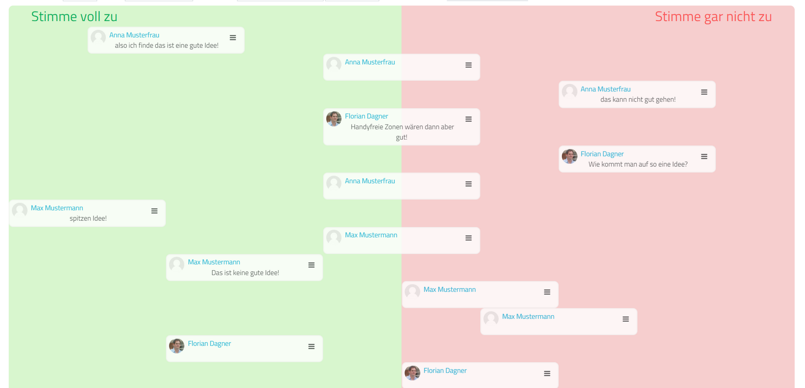

# My Opinion

My Opinion is a preset for the Moodle activity database.

## Getting started

Download the source code and zip the files WITHOUT parent folder. Create a "Database" activity in Moodle and then upload the ZIP file in the "Presets" tab under "Import".

## Language Support

The preset is available in German, but there is not so much to translate. The template can easily be adapted.

## Description

The method is suitable to make different positions, which the students represent, visible and thus to get into conversation and discussion with each other.

## License

https://creativecommons.org/licenses/by/4.0/

## Screenshots

